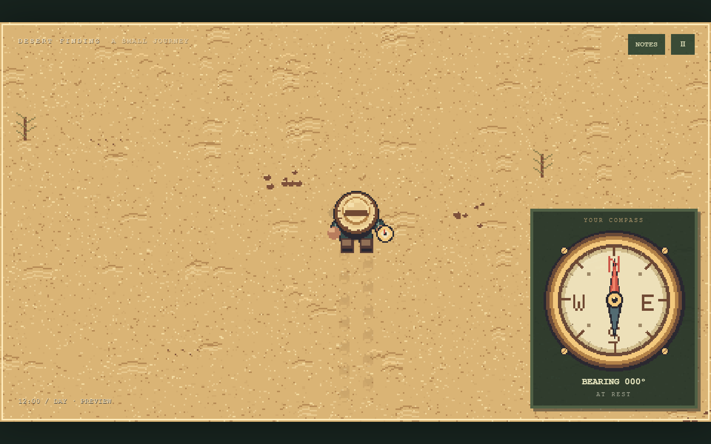
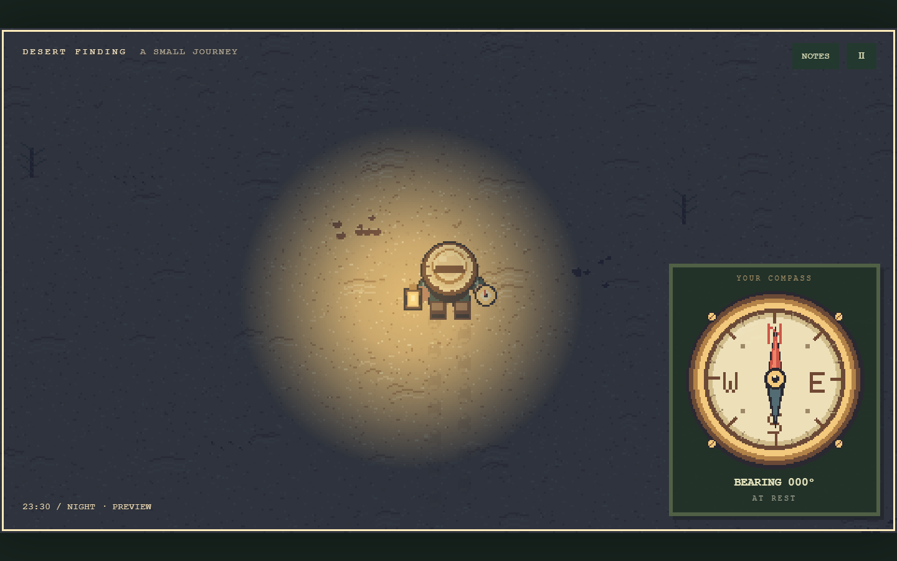
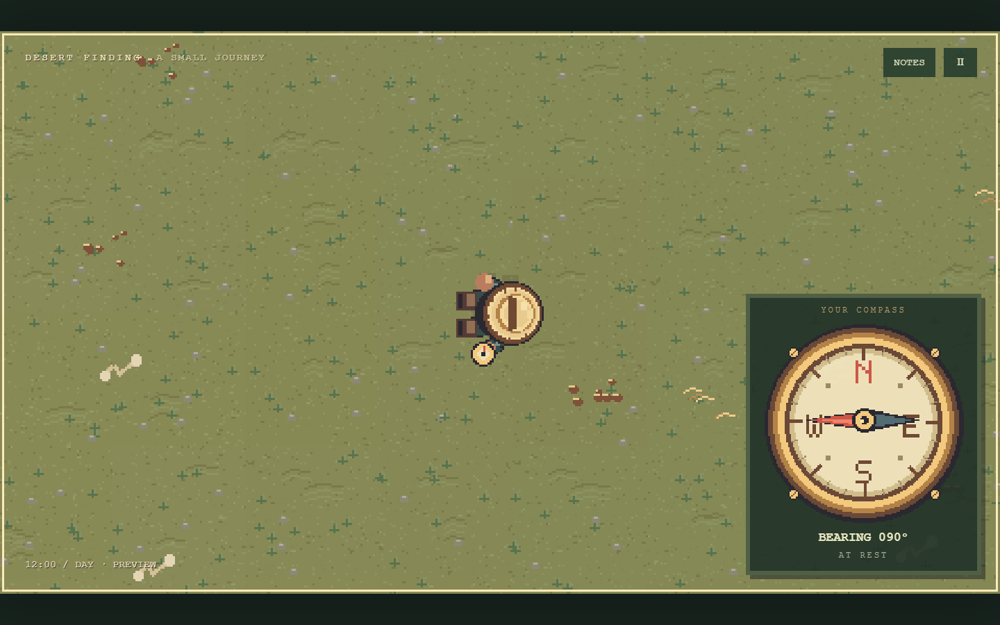
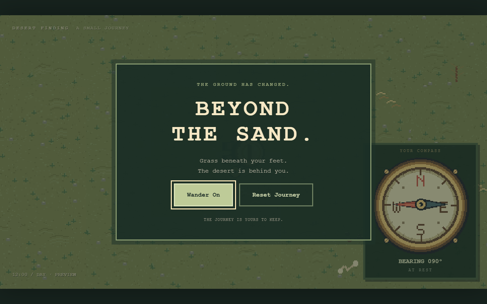

# Desert Finding V2 — Verification

Verified locally on 2026-10-08 with Node 24.20.0 and Playwright Chromium. The repository contains the revised wandering premise, preserved original art and the Pages test/deploy workflow.

## Executed checks

- `npm test`: **32 passed**, 0 failed.
- `npm run test:browser`: **21 passed**, 0 failed against a real local HTTP server. Subsequent targeted checks passed after final menu/save-isolation refinements.
- `python verify_assets.py`: **126 atlas cells, 5 static images, 2 reference previews, 4 compass cases and 5 documents passed**.
- `node scripts/world-report.js`: independent 32,768-vertex polygon integration and physical travel calculations below.
- `node scripts/package-site.js`: static runtime packaged with project-relative URLs; the full Chromium suite includes `/Desert-Finding/` and offline-after-load checks.

Browser checks use real clicks/taps and keyboard controls. The long-distance fixture explicitly opts into debug mode, places the traveler three physical meters inside the eastern boundary, then walks at normal speed through the edge. Normal sessions have neither shortcut methods nor a nearby ending. Save tests advance a reproducible five-hour navigation state in a separate QA namespace, reload, and compare exact coordinates/drift. Background tests skip an inactive hour and verify no travel was granted. A new click corrects drift while the compass keeps reading actual orientation.

Screenshots were visually inspected for day/night, sunrise shadows, mobile text and menus, edge vegetation and the subtle escape ending. Source assets are unchanged; the grass/stone transition is drawn procedurally in the existing pixel style.

## Measured scale

| Quantity | Result |
| --- | --- |
| Target enclosed area | 9,200,000 km² |
| Independently measured polygon area | 9,199,999.899548 km² |
| Relative area error | −0.000001092% |
| Physical walking speed | 5000 / 3600 = 1.388888889 m/s |
| Visual pace | 32.4 px/m × walking speed = 45 px/s |
| Default-seed minimum radius | 1,218.431 km |
| Default-seed maximum radius | 2,489.314 km |
| Equal-area circular radius | 1,711.272 km |
| Equal-area circular straight travel | 342.254 hours / 14.2606 days |

| From origin | Distance | Straight travel at 5 km/h |
| --- | --- | --- |
| North | 1,245.361 km | 249.072 hours |
| East | 2,132.368 km | 426.474 hours |
| South | 1,302.581 km | 260.516 hours |
| West | 2,445.965 km | 489.193 hours |

Area tests independently integrate four seeds. All 360 integer-bearing radial routes are checked for their interior and exterior; 24 perimeter fixtures verify actual walking triggers escape. Long uncorrected night walks accumulate full heading rotations, daylight/landmarks reduce drift, and identical seed/state/timestep sequences reproduce exactly. These drift coefficients are design choices inspired by research, not measured human parameters.

## Captured game views

## Release checks

The workflow installs locked development dependencies, runs both suites, packages only the static runtime, and deploys through GitHub's official Pages actions. Remote workflow/deployment completion and the live project URL are verified separately during release; local screenshots alone are not proof of publication. Saves are browser/site-local, and disabled or full storage is reported in-game.
